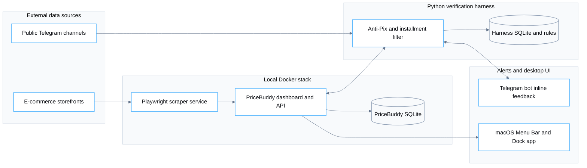

# Agentic AI Blackfriday Monitor

Self-hosted, local-first Black Friday price intelligence monitor combining PriceBuddy, an ARM64 Playwright headless scraper, a Python anti-fake-discount harness with public Telegram deal feeds, human-in-the-loop feedback rules, and native macOS desktop companions.



## Key features

- **Anti-Pix and cash-only protection:** Filters out cash-only promotional prices when interest-free installment markers are missing, ensuring alerts reflect real card pricing.
- **Anti-installment-unit trap:** Strips monthly installment snippets before total price extraction so a single `10x` payment is never misread as an 80% discount.
- **Traffic-light dashboard:** Custom Blade patches add green, yellow, and red target-distance pills directly onto product cards while suppressing misleading percentage-match badges above target price.
- **Public Telegram deal ingestion:** Scrapes configured public deal channels via `t.me/s/<channel>` without storing personal Telegram user sessions.
- **Human-in-the-loop feedback:** Inline `Good alert` and `False positive` buttons on Telegram notifications automatically update `feedback_rules` in SQLite to block accessory spam and raise price floors.
- **Apple Silicon ready:** Includes a custom ARM64 Flask + Gunicorn + Chromium Playwright container alongside an optional ~80 KB native Cocoa Menu Bar monitor for macOS.

## Repository structure

| Path | Purpose |
| --- | --- |
| `docker-compose.yml` | Localhost-bound Docker stack for PriceBuddy and the Playwright scraper |
| `scraper/` | ARM64 and x86_64 Playwright headless rendering microservice |
| `patches/` | SQLite `json_each` store-filter fix and traffic-light Blade UI components |
| `harness.py` | Verification engine, Telegram channel collector, adaptive cadence, and feedback loop |
| `harness_db.py` | SQLite schema initializer and baseline loader |
| `baselines.example.json` | Sample watchlist template for customizing tracked products |
| `macos/` | Native Objective-C Menu Bar app (`PriceBuddyBar.m`) and Dock launcher installer |
| `docs/ARCHITECTURE.md` | Detailed component breakdown and data-flow boundaries |

## Security and privacy

- **No committed secrets:** `.gitignore` blocks `.env`, `harness.env`, `*.sqlite`, runtime logs, and personal `baselines.json` overrides.
- **Loopback isolation:** Containers bind strictly to `127.0.0.1` so neither the dashboard nor the headless browser is exposed on your network.
- **Read-only alerting:** No payment credentials or autonomous checkout flows exist anywhere in the codebase. See [SECURITY.md](SECURITY.md) for details.

## Quickstart

### 1. Configure environment templates

```bash
cp .env.example .env
cp harness.env.example harness.env
cp baselines.example.json baselines.json
```

Update `APP_USER_EMAIL` and `APP_USER_PASSWORD` in `.env`, then start the container stack:

```bash
docker compose up -d --build
```

Generate a Laravel `APP_KEY` if your `.env` does not have one yet and clear compiled views:

```bash
docker exec bf-pricebuddy php artisan key:generate --force
docker exec bf-pricebuddy php artisan view:clear
```

### 2. Generate a PriceBuddy API token

Create a Sanctum personal access token inside the running container and paste it into `PRICEBUDDY_API_TOKEN` inside `harness.env`:

```bash
docker exec bf-pricebuddy php artisan tinker --execute="echo App\Models\User::first()->createToken('harness')->plainTextToken;"
```

### 3. Initialize Python and SQLite

```bash
python3 -m venv .venv
source .venv/bin/activate
pip install -r requirements.txt
python harness_db.py
```

### 4. Run a verification cycle

```bash
python harness.py --run --force --refresh-live
python harness.py --status
```

### 5. Schedule automated polling

Run the monitor periodically with `cron` during warm-up and peak shopping windows. The built-in cadence manager skips redundant runs outside the configured window:

```cron
*/15 * * * * cd /path/to/agentic-ai-blackfriday-monitor && .venv/bin/python harness.py --run --refresh-live >> logs/cron.log 2>&1
```

## Optional macOS companions

Build and launch both the standalone Chrome `--app` Dock window and the native top Menu Bar traffic-light indicator:

```bash
chmod +x macos/install_apps.sh
./macos/install_apps.sh
```

The Menu Bar binary polls `/api/products` every 60 seconds over loopback, displays live `🟢 🟡 🔴` counts next to your clock, and lets you jump straight to products near or at your target price.

## Customizing your watchlist

1. Add product URLs in the PriceBuddy dashboard or via REST API and configure store selectors.
2. Mirror each `product_id`, `normal_price`, `target_price`, `min_price_floor`, `match_groups`, and `exclude_terms` inside `baselines.json`.
3. Re-run `python harness.py --init-only` to sync updated targets into `storage/harness.sqlite`.
4. Optionally add `TELEGRAM_BOT_TOKEN` and `TELEGRAM_HOME_CHANNEL` in `harness.env` to receive interactive alerts.

## License

Released under the [MIT License](LICENSE).
